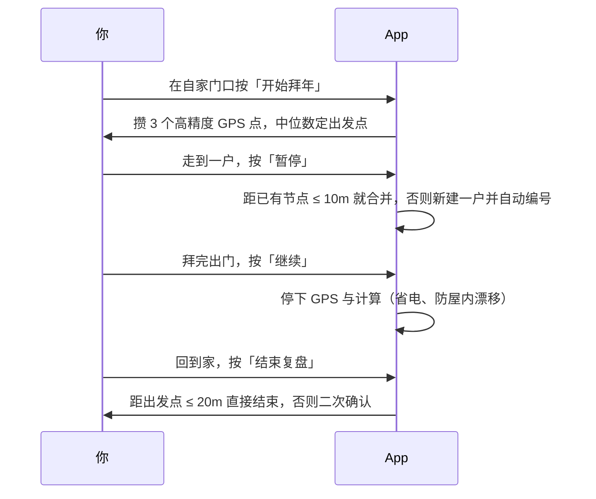

# 拜拜（baibai）

[](https://github.com/ChenChen913/baibai/actions/workflows/pages.yml)
[](LICENSE)

乡村拜年轨迹复盘玩具

记录大年初一走村串户的真实轨迹，回放当日路线，对比「今年实走 / 当日最优 / 飞行最优」三条线——看看自己今年绕了多少路。

- **在线使用**：<https://chenchen913.github.io/baibai/>（手机浏览器打开，可添加到主屏幕）
- **安卓版**：从 [GitHub Releases](https://github.com/ChenChen913/baibai/releases) 下载 APK


## 目录

- [为什么做这个项目](#为什么做这个项目)
- [快速开始](#快速开始)
- [用法](#用法)
- [配置](#配置)
- [项目结构](#项目结构)
- [开发](#开发)
- [常见问题](#常见问题)
- [已知限制](#已知限制)
- [如何贡献](#如何贡献)
- [许可证](#许可证)

## 为什么做这个项目

每年大年初一都要走村串户拜年。走完一圈坐下来，常有一个疑问：今天到底绕了多少路？如果换一个顺序走，能省下多少？

运动轨迹类 App 记录的是「路线」本身，不回答「这一圈拜访的路线合不合理」。所以这个项目在记录轨迹之外，会把当天的节点当作一个旅行商问题（TSP）来解：

| 线路 | 权重 | 没走过的路段怎么算 |
|---|---|---|
| 飞行最优 | 直线距离 | 永远可算，纯几何 |
| 距离最优 | 平滑后的实走长度 | 直线 × 1.3 绕行系数（图上标虚线） |
| 时间最优 | 真实行程耗时（同一对节点多次实走取最短） | 距离 ÷ 步行 1.35 m/s |

节点数 ≤ 16 时用 Held-Karp 动态规划求精确解，超过则退化为贪心 + 2-opt 启发式。三条线和今年实走叠在同一张画布上对比，压轴动画再把实走轨迹变形为飞行航线。

## 快速开始

前置要求：**Node.js ≥ 22.22.2**（或 ≥ 24.15.0）。版本下限由测试依赖 `jsdom@30` 的 `engines` 决定——用 Node 20 或 22.19 会 `npm ci` 通过、`npm test` 失败。

```sh
git clone https://github.com/ChenChen913/baibai.git
cd baibai
npm install
npm run dev
```

打开 <http://localhost:3000> 即可看到效果。

> 只想用、不想跑代码：直接用上面的在线地址，或用安卓版 APK。线上与本地是同一份前端代码，没有后端。

## 用法

拜年当天的操作只有两个键，其余都交给自动判断：



出门前可选做一件事：在「拜年清单」里导入去年名单（或手动添加），当天结束时会自动比对，把没去的户标红。

回到家打开「回顾页」可以改名、合并误拆的户、拆分重复到访、剔除异常跳变点；再进「三线对比」看成绩单与压轴动画。骑行段在出发前点一下「骑车」，到下一户会自动回到走路。

## 配置

**不需要任何配置。** 项目没有后端、没有账号，也没有需要填写的密钥或环境变量；轨迹数据只存在你自己手机或电脑的浏览器里（IndexedDB）。

| 环境变量 | 必填 | 默认值 | 说明 |
|---|---|---|---|
| — | — | — | 无用户可配置项 |

代码里唯一读到的环境变量是 Vite 内建的 `import.meta.env.PROD`，用于判断是否注册 Service Worker（开发环境不注册，避免热更新被缓存污染）。

换手机时用「导出 JSON / 导入 JSON」搬家，网页版与安卓版是同一份格式，可以互相导入。

## 项目结构

| 路径 | 职责 |
|---|---|
| `src/` | 网页版源码（TypeScript）：状态机、轨迹算法、TSP、IndexedDB、地图、五个视图 |
| `tests/` | 网页版 vitest 测试（状态机、算法、存储、投影、UI 冒烟） |
| `public/` | Service Worker、PWA manifest、应用图标 |
| `index.html` | 网页版入口 |
| `android/` | 安卓原生版 Gradle 工程（`core` 纯 Kotlin 算法层 + `app` Compose 界面层） |
| `docs/` | 需求文档、D0–D22 决策记录、M1–M5 规格、UI 设计提示词、审核清单 |
| `.github/workflows/` | 两条流水线：`pages.yml`（测试 → 构建 → 部署 Pages）、`android.yml`（Gradle 测试 + 产出 APK） |

网页版的核心分层：

```
src/
├── state.ts       # 会话状态机（IDLE/WALKING/PAUSED/FINISHED + 撤销链 + 检查点）
├── geo.ts         # 球面距离、中位数、最近邻
├── track.ts       # 分段成边、SVG 视口投影
├── smooth.ts      # 滑动平均 + Douglas-Peucker 抽稀
├── optimize.ts    # 三线优化（飞行/距离/时间）
├── tsp.ts         # Held-Karp 精确解 + 贪心 2-opt
├── db.ts          # IndexedDB（活跃检查点 / 历史会话 / 今年清单）
├── compute.ts     # 计算入口（优先 Worker，无 Worker 时同步回退）
├── main.ts        # 接线：GPS + 状态机 + 存储 + 视图路由
└── *-ui.ts        # 记录页 / 回顾页 / 三线页 / 清单页 / 地图
```

安卓端的 `core` 模块是纯 Kotlin（无 `android.*` 依赖），算法与网页版逐位对齐，两端各有测试互相约束。

## 开发

```sh
npm run dev      # 开发服务器 → http://localhost:3000
npm test         # 单元测试（158 项）
npm run lint     # 类型检查（tsc --noEmit）
npm run build    # 类型检查 + 生产构建 → dist/
npm run preview  # 本地预览生产构建
```

测试输出形如：

```
 ✓ tests/projection.test.ts (8 tests) 14ms
 ✓ tests/state.test.ts (34 tests) 66ms
 ✓ tests/village-sim.test.ts (2 tests) 443ms

 Test Files  18 passed (18)
      Tests  158 passed (158)
```

其中 `village-sim.test.ts` 会用固定随机种子模拟一个真实的村庄：15~20 户散布在约 950m × 720m 范围内，按刻意绕路的蛇形顺序拜访，叠加 GPS 抖动、户内停留、一段骑行和一次回访，最后校验三线结果与性能。

安卓端需要 JDK 17 与 Android SDK，在 `android/` 下执行：

```sh
./gradlew test          # core（124 项）+ app（35 项）
./gradlew assembleDebug # 产出 app/build/outputs/apk/debug/app-debug.apk
```

**部署**：推送到 `main` 即自动发布——`pages.yml` 跑测试与构建后部署到 GitHub Pages；带 `android/**` 变更的推送会触发 `android.yml` 构建 APK（作为 CI 产物；正式发布见 Releases）。

延伸阅读：需求与非目标见 [docs/项目需求文档.md](docs/项目需求文档.md)，决策档案见 [docs/拷问决策记录.md](docs/拷问决策记录.md)，验收标准见 [docs/项目审核清单.md](docs/项目审核清单.md)，两端数据契约见 [android/数据格式.md](android/数据格式.md)，完整更新历史见 [docs/CHANGELOG.md](docs/CHANGELOG.md)。

## 常见问题

**Q：`npm run dev` 打开 5173 端口是空的？**
A：本项目把开发端口固定为 3000，见 `vite.config.ts` 的 `server.port`。访问 <http://localhost:3000>。

**Q：`npm test` 报 Node 版本不支持？**
A：测试依赖 `jsdom@30` 要求 Node ≥ 22.22.2（或 ≥ 24.15.0）。`npm ci` 只警告不拦截，所以问题会延迟到跑测试时才出现。

**Q：手机浏览器定位不到？**
A：微信内置浏览器常拦截定位，改用系统浏览器（Safari / Chrome）打开。室内搜不到卫星属正常，到窗边或户外即可；App 会明确提示而不是一直转圈。

**Q：记录过程中手机息屏，轨迹断了？**
A：记录时页面会申请 Wake Lock 保持亮屏，但 iOS Safari 不支持该 API，需要在系统设置里把「自动锁定」设为「永不」。安卓版用前台服务 + 唤醒锁，锁屏可继续记录。

**Q：为什么静止时地图上的轨迹不跟着抖？**
A：GPS 漂移点会被过滤掉——平滑窗口未满 3 个采样不入库、静止门槛随静止时长抬升（0.5 m/s，封顶 50m）、连续 2 次确认才入库。这是真机反复调试后的结果，详见 [docs/CHANGELOG.md](docs/CHANGELOG.md) 里 R7–R9 的记录。

**Q：导出的 JSON 能在两端互相导入吗？**
A：可以。网页版与安卓版共用同一份数据格式（见 [android/数据格式.md](android/数据格式.md)），导入时会校验文件标识、版本与字段完整性，不合规的文件会被拒绝并说明原因。

## 已知限制

- **个人自用**：不做多用户、无账号、无云同步。数据只在你的设备上，换设备靠导出/导入 JSON。
- **不做「明年路线规划」**：与「年度独立」的设计冲突，明确不做。
- **不做 RTK / 高精度差分定位**：户间距 200~500m，手机自带 GPS 足够。
- **不做 OSM 路网吸附层**：需要在线路由服务，与离线优先的目标冲突；三线页用直线/折线示意代替。
- **网页版依赖浏览器 Geolocation 与 Wake Lock**：iOS Safari 不支持 Wake Lock，需手动设置屏幕常亮。
- **安卓版是 debug 签名**：仅供自用安装，未做 release 签名与商店上架。
- **边级异常样本识别尚未实现**：需求里写过「比同边中位数慢 2 倍标异常」，目前只实现了轨迹点级的跳变防护与人工剔除，边级自动识别未落地（[docs/项目需求文档.md](docs/项目需求文档.md) 已如实标注）。
- **安卓端尚无自动化 UI 测试**：Compose 界面层靠真机验收，CI 只覆盖编译与 core/app 单元测试。
- **地图瓦片来自第三方**：默认用高德瓦片（失败自动回退 OSM / Esri），离线时靠 Service Worker 缓存，未预载的区域断网会显示空白底图，但轨迹与标记照常绘制。

## 如何贡献

欢迎提 [Issue](https://github.com/ChenChen913/baibai/issues) 和 PR。改动前建议先读 [docs/项目需求文档.md](docs/项目需求文档.md) 与 [docs/项目审核清单.md](docs/项目审核清单.md)——后者是本项目的验收标准，也说明了「什么问题算问题」。

网页版与安卓版的算法必须保持一致：`src/*.ts` 与 `android/core/**/*.kt` 的常量、公式、边界语义要逐位对齐，两端都有测试互相约束。改了一端请同步另一端。

## 许可证

[Apache-2.0](LICENSE)（个人项目，欢迎 fork 与改进）。

第三方依赖许可见 [THIRD_PARTY_NOTICES.md](THIRD_PARTY_NOTICES.md)。

### 借鉴与署名

本项目为原创项目（git 历史单根提交），未复刻任何仓库；以下项目与数据源为本项目提供了思路、组件或数据：

| 来源 | 用途 | 许可 |
|---|---|---|
| [Organic Maps](https://organicmaps.app) | 离线优先地图架构思路（离线底图、省电定位调度、断点续传下载），参考调研见 [docs/organicmaps-调研与移植规划.md](docs/organicmaps-调研与移植规划.md)；未直接复用其代码或地图数据 | Apache-2.0（代码）/ ODbL（地图数据） |
| [OpenStreetMap](https://www.openstreetmap.org) | 网页版备用瓦片（瓦片失败时的兜底源） | © OpenStreetMap contributors（ODbL） |
| 高德地图瓦片 | 安卓/网页主底图（普通地图 + 卫星图） | 遵循高德瓦片服务条款 |
| [Leaflet](https://leafletjs.com) | 地图交互引擎（两端） | BSD-2-Clause |

> 若未来直接使用 Organic Maps 的代码或地图数据，按其要求须在可见位置署名
> "Map data © OpenStreetMap and Organic Maps" 并附可点击链接、禁止白标——详见 [docs/离线地图改造-实施手册.md](docs/离线地图改造-实施手册.md)。
